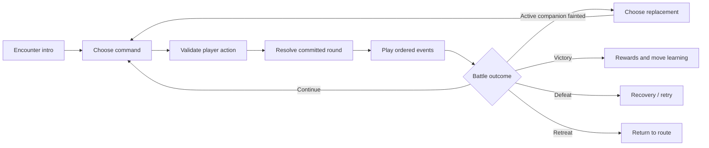

# Combat redesign specification

Proposed for review · 2026-11-04 · See [the master brief](README.md).

The visual staging below is compatible with the new [AI-coaching proposal](AI_IDENTITY.md). That proposal is still under discussion; the final command/teaching flow must be reviewed after choosing how centrally real models participate.

## The experience

A battle takes over the game viewport. The player's active companion appears from the back in the near foreground; the opponent faces them across a small, region-specific battlefield. Introductions, commands, attacks, HP changes, recovery and rewards have readable stages. Team choice matters throughout the encounter.

Use the familiar rhythm of an older handheld creature RPG while giving AI Frontier its own creatures, moves, effects and world. Offline battles are resolved by local game rules. The live-model entertainment arena continues to display actual provider outputs under its own scoring rules.

## Battle layout

- Battlefield occupies roughly the upper 65–70% on desktop. A grass clearing, bridge, courtyard or Archive chamber places the encounter in the world the player just left.
- Opponent HUD is near the upper left; its front sprite occupies the far right. Player back sprite is in the near left; player HUD sits to the right, above the command area. Preserve sightlines and avoid covering faces.
- Each HUD shows name, level, an affinity icon/label, HP bar and numeric health. The player's HUD also shows energy. Three party markers indicate ready, active or fainted using shape plus colour.
- The command area pairs a short event/prompt line with **Fight / Team / Pack / Retreat**. Fight opens four equipped moves in a 2×2 arrangement; Back restores the previous selection.
- A selected move reveals its affinity, energy cost, effect and priority before confirmation. Disabled moves explain the missing resource. No tooltip is required for basic understanding.
- On a phone, use a shorter battlefield above a full-width command area and retain 44px targets and 16px text. HUDs reflow; the entire desktop UI is never scaled down as an image.
- Essential UI remains real DOM text/buttons over the Pixi scene, with explicit focus, keyboard navigation and an optional accessible battle log.

## Team and moves

The active team has up to three companions, with one on the field. Each owns HP, energy, level, four equipped move slots and one simple passive. New players learn a basic move and a guard first; additional moves open through the chapter. The profile shows the next unlock clearly.

Start with four readable combat stats: **Health, Force, Guard, Speed**. Keep numeric ranges small. Appearance, provider reputation and actual model benchmarks do not change these game stats.

Provisional chapter tuning:

| Rule | Initial setting |
| --- | --- |
| Early companion HP | 28–36 |
| Energy | Maximum 6; begin encounter at 3 |
| Basic move | Costs 0; restores 1 energy after resolving |
| Defensive move | Costs 0; restores 1 energy; halves the next incoming hit that round |
| Tactical/special moves | Cost 1–3 energy; no action may reduce energy below zero |
| Affinity | Ember beats Grove, Grove beats Tide, Tide beats Ember |
| Advantage/resistance | ×1.25 / ×0.8; neutral ×1 |
| Chapter status effects | Shielded, Scorched, Slowed only |
| Accuracy and critical hits | No random misses or random criticals in the first release |

Starting damage model: `max(1, floor((move.power + attacker.force - floor(defender.guard / 2)) * affinity * shield))`. Shield is 0.5 when applicable, otherwise 1. Clamp authored content to valid non-negative stats; resolve immunities or scripted zero-damage effects explicitly rather than through this minimum-damage formula. A free guard never also deals damage unless a move says so. Balance numbers are tuning candidates and must be checked in simulated matchups and playtests.

Scorched deals `max(1, floor(maxHp / 16))` at round end for two rounds. Slowed multiplies Speed by 0.75 for two rounds. Shielded applies to one incoming hit that round, then expires. Reapplying refreshes duration; it never stacks. A fainted actor cannot act, heal itself or tick another damage effect. Recovery items and revival eligibility are separate rules.

## Turn contract

1. Enemy policy chooses its intention before the player's command, from its available moves and current state. The policy cannot inspect an uncommitted player action. Tutorials and boss wind-ups communicate a useful tell.
2. The player selects one legal action. Pack and Team show a target/preview and require a final confirmation. Back does not consume a turn.
3. Validate actor, target, energy, inventory and battle phase in pure rules. Invalid input preserves state and returns a useful reason.
4. Resolve order: voluntary switch, item use, move priority, then Speed. A seeded tie-break is recorded in battle state. Switching or using an item consumes that side's action. A slow actor that has fainted loses its pending move.
5. Resolve damage, statuses and round-end effects. Ask for a replacement before the next command if the active companion faints and reserves remain.
6. Commit the next battle state once. Return ordered presentation events with stable IDs: approach, move name, effect, impact, HP change, status, faint, replacement, reward.
7. The renderer plays those events, updates the displayed bars in sequence and returns control. Animation playback never mutates combat state. Fast-forward, reduced motion or a remount cannot deal damage or grant rewards twice.

The rules must never depend on Pixi ticker timing, network availability, image loading or text typing speed.

## Command behaviour

| Command | Behaviour |
| --- | --- |
| Fight | Inspect four move slots; show legal costs; select and confirm a move |
| Team | Inspect HP/energy/role, choose a ready companion, preview the swap; fainted members cannot switch in |
| Pack | Show quantity, exact effect and valid target; consume only on committed use; never spend an item on Back |
| Retreat | Guaranteed exit from an eligible route encounter; disabled with a short explanation in a rival/boss battle |

The first training fight introduces attack, guard, a dangerous enemy tell and switching only after the player has a second companion. It offers a clear retry and healing if lost. Avoid a long lecture or automatic button presses on the player's behalf.

## Presentation and pacing

Send-out, anticipation, movement, impact, HP depletion and text settlement form one coherent action. Give each companion a recognisable idle, signature anticipation pose, attack and hit reaction. Ward has a crisp ring/shield; Tide moves travel in shaped wave clusters; Grove moves use leaves/roots; Ember uses short warm sparks. Use different sounds and motion without filling the scene with particles.

Initial pacing targets: intro under 1.5 seconds, ordinary action around 0.6–0.9 seconds, signature action around 1.2 seconds. These are prototype targets, not measured guarantees. Hold/press Confirm can reveal a complete text line immediately; a speed setting shortens repeated animation. Reduced motion removes camera shake and flashes and uses short sprite changes/crossfades. Important damage, faint and reward events remain understandable with sound muted.

## Victory, defeat and recruitment

Victory gives a short companion celebration, XP for the active team, an optional move-learning choice and a clear quest result. A level-up previews stat changes; a full move set requires choosing what to replace, with a way to review the old move. Apply each reward with an encounter/reward ID so replaying a result cannot farm it.

Defeat returns the trainer to the last safe rest point, restores the team and preserves completed quests and companions. Explain where the player returns and offer retry/navigation. Practice resets its own scenario. A Circuit defeat returns to its explicit circuit checkpoint. The game never erases a save as punishment.

Recruitment is a short authored bond event: help, understand or calm a companion, then invite it to travel. The starter trio and later roster get individual introductions. A defeated hostile creature does not automatically become a provider companion, and story progress does not depend on random capture odds.

## Required validation before replacing current combat

- Same seed, state and commands produce the same outcome and ordered events.
- Speed ties, switching, item targeting, energy limits, status expiry, fainted actions and forced replacements resolve correctly.
- Each starter can beat the training fight; at least one later encounter makes a sensible switch or guard valuable.
- Win, lose, retreat, retry, reload and animation-skip paths never duplicate items, XP or chapter rewards.
- Commands work with mouse, keyboard, touch and a standard gamepad; focus always returns to the active command surface.
- A player can explain why damage happened and choose a move without reading a developer document.
- Scene, portraits, HUDs and result states fit 360×740, 390×844, 1280×720 and 1440×900, including long nicknames and text scaling.
