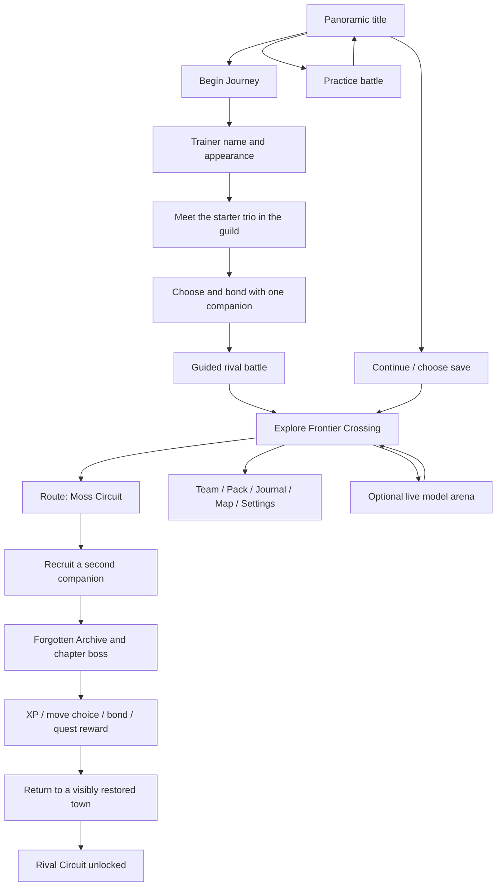

# AI Frontier — GBA adventure redesign

Design review checkpoint · 2026-11-04 · **Plan and visual concepts; application changes await review.**

## Confirmed direction

The player is a trainer travelling with a small team of original AI companions. The visual target is the rich, warm pixel craft of Game Boy Advance adventures. The approved entrance direction is **A: a panoramic title screen**, with **B's detailed village art inside the game**. The requested scope for this checkpoint is a complete design plan and visual concepts to review together.

Open [the visual review board](review.html), [the character bible](CHARACTERS.md), [the combat specification](COMBAT.md), and [the build plan](IMPLEMENTATION.md). Generated images are concept references; the production sprite and tile contracts are defined in the build plan.

## What needs to change

The current implementation is a useful rules prototype, but its presentation does not carry the adventure promise. These findings come from the existing source, not a new performance or usability study.

| Current implementation | Effect on the player | Redesign decision |
| --- | --- | --- |
| `Title.jsx`: text, three small sprites, static stars and rectangular skyline | Little sense of the place or the journey | A panoramic world, recognisable trainer and companions, illustrated logo, immediate game menu |
| `frontier.css`: a nearly uniform navy shell with gold/cyan controls | Town, field, menus and combat share the same mood | Daylight world palettes, light readable dialogue, regional lighting, restrained state accents |
| `WorldScene.jsx`: rectangular ground/building primitives and one NPC stencil | Landmarks and characters are difficult to remember | Authored tile layers, distinct architecture, animated NPCs, paths, interiors and foreground occlusion |
| `world.js`: three 20×12 rooms with interactable exits | Walking feels like navigating a test map | A connected town, route and destination with natural entrances, loops, secrets and shortcuts |
| `pixelData.js`: 18×20 character grids reused at every scale | Faces and personalities disappear during important moments | Separate portrait, field, battle-front and battle-back artwork for each companion |
| `World.jsx`: battle inside the generic `Panel` dialog | The encounter feels like a form over the world | A dedicated battle scene with staging, animation, commands, party switching and results |
| `worldState.js`: one player HP pool, one enemy and three shared moves | Little attachment to a team or reason to change tactics | Individual companion state, roles, four equipped moves, authored encounters and progression |
| RPG and live arena use visibly different UI languages | A scene change breaks the game's identity | Shared frame, portrait, typography, transition and sound rules across every mode |

## The player promise

**Meet your companion. Follow the signal. Build a team worth coming back to.**

The first chapter should deliver a small, memorable adventure: a welcoming town, an intriguing route, a rival, a discovery, a meaningful battle and a changed homecoming. AI provider identity informs the original companions and optional live challenges. The game itself must make sense to someone who has never used an API key.

Design references: Pokémon Emerald for travel rhythm and front/back battle staging; Golden Sun for an inviting landscape and battle presence; The Minish Cap for readable small-town detail. The characters, map, interface artwork, story and audio remain original.

## Art direction

**Scene sentence:** A player opens the game on a laptop in the evening or a phone during a break and wants the feeling of stepping into a sunlit handheld adventure with a familiar companion waiting for them.

Use a full palette carried by the environment. The default world is bright; forests create cool shelter and the Archive earns deeper shadows. Warmth comes from sun, roofs, paths, character expressions and sound. Menu surfaces use quiet light fills with strong dark text.

| Role | Proposed colour | Use |
| --- | --- | --- |
| River sky | `#83CBE3` | Open sky and distant water |
| Deep jade | `#35654F` | Tree mass, depth and foliage outlines |
| Leaf light | `#A7C875` | Sunlit canopy and readable grass paths |
| Clay roof | `#B95643` | Town identity, selected action details |
| Ochre path | `#D8B06C` | Travel routes and warm stone |
| Plum ink | `#2B2438` | Text, sprite outlines and UI structure |
| Cloud panel | `#F4F6ED` | Dialogue and command surfaces |
| Lantern gold | `#E6B64B` | Selection cursor, important discoveries |

These are starting anchors, not permission to tint every object identically. Each biome gets a controlled ramp of highlights, midtones and shadows. Production tokens must pass measured text contrast; HP, status and affinity also need labels/icons. Avoid noise over every surface, soft blurry pseudo-pixels, a permanent blue overlay, glow around everything and small body text.

The logo is bespoke pixel artwork. Candidate interface families are [Pixelify Sans](https://fonts.google.com/specimen/Pixelify+Sans) for short menu labels and [Atkinson Hyperlegible Next](https://fonts.google.com/specimen/Atkinson+Hyperlegible+Next) for dialogue and descriptions. Verify size, licence and local font files during the art milestone. Body text stays at least 16 CSS px; the scene's resolution never scales the text down.

## The first screen must earn the click

Use the approved panoramic composition as the visual target. The trainer and starter trio occupy the foreground; a path, river, town and distant observatory make the journey visible. The menu sits in a quiet area of the composition and stays usable while the scene loads.

- **Begin Journey** is the main action for a new player. A returning player's **Continue** is first and includes trainer name, companion portrait, chapter and last location.
- **Practice** lets someone try a short battle immediately. **Settings** exposes sound, text speed, motion and controls.
- Slow water, a few leaves, one companion blink and a restrained logo glint give the scene life. An attractive still scene remains visible if animation is off or loading.
- Music starts after an intentional interaction. Use a memorable short melody and a soft menu cursor sound, with independent music/effects controls.
- On mobile, art recomposes around the trainer rather than shrinking the whole desktop image. A dedicated mobile crop and a menu below its focal point preserve the destination and the companions.
- The title's menu, save selection, settings, loading, focus, offline start and failure/retry states receive the same art care. API setup belongs inside the optional live arena entrance.

## Complete player flow

The existing faction story becomes a relationship with guilds encountered during play. The first decision is the companion the player likes, not a paragraph of faction mandates. Each starter can complete the chapter; field abilities offer different discoveries or shortcuts without blocking the main route.

## World and exploration

**Frontier Crossing:** a river town with the Companion Guild, a healing garden, a small market, a rival practice space and the old relay landmark. Terracotta roof silhouettes, a bridge and a large relay tree anchor navigation. Two enterable buildings make the place feel inhabited. NPCs face the player, have distinct portraits and short readable conversations.

**Moss Circuit:** an authored route with a main path, one optional loop, a visible encounter area, a recruitable companion, a rest point and a shortcut back to town. Use environmental clues and signposts instead of a permanent paragraph at the bottom of the screen. Encounters are visible or triggered in clearly marked terrain; the starter tutorial cannot interrupt every few steps.

**Forgotten Archive:** a compact destination with a visual relay puzzle, lore discovered through objects, a rival/boss encounter and a visible restoration payoff. Violet shadow is a regional accent here, not the palette of the whole product.

Trainer movement has directional walk frames, short interpolation between grid positions, held-key/touch-repeat support, obstacle feedback and a following lead companion. Camera movement is bounded and gentle. Foreground canopy and roofs sort correctly around actors. Natural paths cross region boundaries; doors lead to interiors with consistent facing and return positions.

## Modes and return paths

| Mode | Experience | Entry and exit | Progress |
| --- | --- | --- | --- |
| Journey | Story, exploration, recruitment and tactical battles | Begin/Continue; save and return to title | Main local save |
| Practice | Guided first battle or repeatable team experiment | Title; explicit retry, team edit and exit | Separate practice state; no story reward farming |
| Rival Circuit | Three short rival matches and a final challenge | Town board after the tutorial chapter; clear checkpoint/retry | Circuit record and one-time unlocks |
| Live Arena | Existing entertainment challenges using actual model responses | Optional town destination; provider consent and return to the same position | Separate match results; fantasy combat stats are not benchmarks |

The first release target includes the first three local modes. The current Roast, Prompt Injection and Impersonation features remain live arena modes and receive the common visual language. Shared online exploration and ranked PvP follow only after the local game is strong.

## Menus and secondary screens

| Surface | Required experience |
| --- | --- |
| Trainer setup | Name, clear appearance previews, confirm/back, no gameplay advantage from appearance |
| Starter selection | Large expressive avatar, idle preview, role and one understandable signature move; freely inspect all three before confirming |
| Dialogue | Speaker portrait, short pages, instant text/repeat controls, choices with clear consequences |
| Team | Three active slots, current health/energy, leader/follower choice, reorder, swap and inspect |
| Companion profile | Avatar, nickname, affinity, role, four equipped moves, bond moment and next learnable move |
| Pack | Usable items, quantity, effect and valid target; no unexplained disabled actions |
| Journal | One tracked objective, discovered leads, completed chapter recap and faction relationships |
| Map | Actual routes, player marker, visited landmarks and a readable legend; useful at phone size |
| Battle/result | Dedicated scene, command hierarchy, victory/defeat/retry, XP, move learning and return |
| Settings | Audio, motion, text speed, controls, save export/import and title return |
| Save selection | Location and party preview, clear slot selection, migration/recovery and explicit overwrite confirmation |
| Live arena setup/result | Matching portraits and pixel frames, exact model identity, connection state, call consent, output inspection and return |

## Review and completion bar

This checkpoint delivers a direction and assets for review. Production implementation begins after reviewing the remaining avatar and battle concepts. The existing application remains the playable baseline until the first complete replacement loop is ready.

The next implementation checkpoint must show the same artistic quality in the title, town and battle. A player should identify a companion by silhouette, understand a turn without a technical explanation, complete the first objective without guidance, recover from defeat and resume after refresh. See [IMPLEMENTATION.md](IMPLEMENTATION.md) for the staged build gates and measurement plan.
